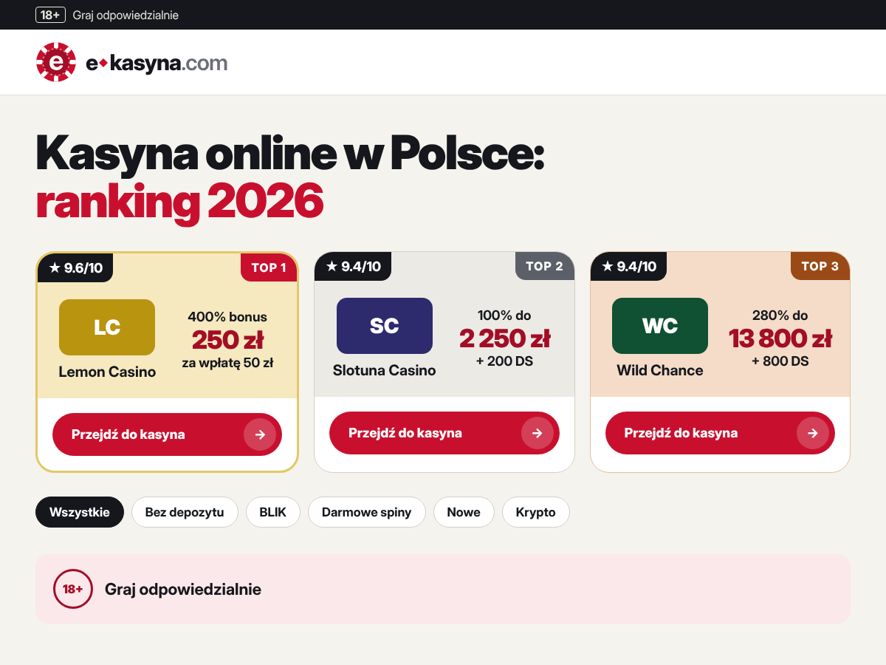

# e-kasyna — тема WordPress

Тема для сайта-рейтинга онлайн-казино для игроков из Польши (e-kasyna.com). Весь интерфейс на польском.



## Что внутри

- **Рейтинг казино.** Подиум TOP-3 (золото, серебро, бронза) и строки для мест 4+. В каждой карточке:
  - угловые ярлыки «★ 9.6/10» и «TOP N»;
  - бонус в три строки;
  - метка редакции с галочкой;
  - таблица «Licencja | Czas wypłat | Osobliwości» с номером лицензии;
  - кнопка «Przejdź do kasyna» и ссылка «Opinie o …».
- **Фильтры рейтинга** по категориям (`?ek_kat=blik`). Работают на сервере, без JS, ссылки индексируемые.
- **Тип записи «Kasyno»** (`/recenzje/…`) со всеми полями обзора. Полный рейтинг — `/ranking-kasyn/`, категории — `/kasyna/{slug}/`.
- **Страница обзора:**
  - хлебные крошки и оценка;
  - блок «Najlepsze bonusy {kasyno}» — сетка карточек всех бонусов казино: тип, условия, промокод с кнопкой «Kopiuj», «Odbierz bonus»;
  - таблица «Informacje o kasynie» в две колонки (Kasyno, Strona, Licencja, Właściciel, Rok, Wsparcie, Producenci, Wpłaty, Wypłaty…); длинные списки сворачиваются в «+N więcej»;
  - плюсы и минусы, карточка бонуса и похожие казино в сайдбаре.
- **Страница «Wszystkie kasyna online»** (шаблон «Wszystkie kasyna (A–Z)» или шорткод `[ekasyna_az]`): алфавитный указатель 0-9 / A–Z с закреплением при прокрутке, поиск по названию, все казино сгруппированы по буквам, у каждого логотип и оценка.
- **Автор и даты:**
  - строка автора под заголовком с датой обновления;
  - карточка автора внизу: опубликовано, обновлено, дата теста, кто проверил факты;
  - поля «Stanowisko» и «Tematy» в профиле пользователя.
- **Оглавление:** строится автоматически из H2 и подсвечивает текущий раздел.
- **FAQ:** стилизованный стандартный блок «Szczegóły» (core/details).
- **Schema.org JSON-LD:** `Review` с `reviewRating` для обзоров, `Article` с `dateModified` и автором для записей и страниц.
- **Ответственная игра:** полоса 18+ сверху и блок «Graj odpowiedzialnie» над футером. Ссылки на помощь задаются в кастомайзере.
- **Мобильная версия:** закреплённая плашка бонуса «выбора редакции» и кнопка «наверх».
- **Логотип:** знак-фишка с буквой «e» и вордмарк e◆kasyna.com, фавикон SVG.

## Статический просмотр на GitHub Pages

В папке `docs/` лежит готовый HTML-просмотр темы, сгенерированный из WordPress на демо-данных. На главной `docs/index.html` по одному примеру на каждый шаблон (главная, рейтинг, страница бонусов, обзор, A–Z, статья, 404) и отдельно поп-апы. Остальные демо-страницы тоже сгенерированы, чтобы ссылки внутри примеров работали, но в список не включены.

Как включить:
1. **Settings → Pages**.
2. **Source:** Deploy from a branch.
3. **Branch:** `main`, папка **`/docs`** → **Save**.
4. Через 1–2 минуты просмотр откроется по адресу **https://yuliaoliyar.github.io/ekasyna/**.

В статическом просмотре не работают поиск по сайту и комментарии: это функции WordPress. Фильтры рейтинга ведут на страницы категорий.

Как пересобрать после изменений: запустите WordPress с этой темой и выполните

```bash
python3 tools/build-preview.py --site http://localhost:8080 --wp /путь/к/wordpress --urls tools/urls.json
```

`tools/urls.json` — список страниц вида `["/recenzje/lemon-casino/", "Recenzja: Lemon Casino", "Recenzje"]`.

## Онлайн-просмотр (без хостинга)

Тема на PHP, поэтому GitHub Pages её не запустит. Посмотреть её можно в **WordPress Playground**: откройте ссылку, и WordPress в браузере сам установит тему из этого репозитория, импортирует демо-казино и включит красивые ссылки.

**[▶ Открыть демо в WordPress Playground](https://playground.wordpress.net/?blueprint-url=https://raw.githubusercontent.com/YuliaOliyar/ekasyna/main/blueprint.json)**

Сценарий загрузки лежит в `blueprint.json`. Данные в Playground не сохраняются: после перезагрузки страницы демо собирается заново. Вход в админку: `admin` / `password`.

## Установка

1. Скопируйте папку в `wp-content/themes/ekasyna` (или загрузите zip через «Wygląd → Motywy → Dodaj nowy»).
2. Активируйте тему. Автоматически создадутся 6 категорий рейтинга: bez-depozytu, darmowe-spiny, blik, min-depozyt, nowe, krypto.
3. **Wygląd → Dane demo e-kasyna → Importuj.** Добавит 8 казино из текущего рейтинга и страницу «Wszystkie kasyna online» с каталогом A–Z. Необязательный шаг.
4. **Ustawienia → Bezpośrednie odnośniki** → «Nazwa wpisu» (`/%postname%/`), затем «Zapisz».
5. **Ustawienia → Czytanie** → «Strona główna wyświetla: statyczną stronę». Текст этой страницы (SEO-статья, FAQ) выводится на главной под рейтингом, вместе с оглавлением и автором.
6. **Wygląd → Menu.** Назначьте меню на места «Menu główne» и «Stopka — kolumna 1–3».
7. **Wygląd → Dostosuj → Motyw e-kasyna:**
   - hero;
   - выбор редакции;
   - количество казино в рейтинге;
   - тексты 18+ и ссылки на помощь;
   - текст футера.

## Тексты под списками

- **Полный рейтинг** (`/ranking-kasyn/`). Выберите страницу в «Dostosuj → Motyw e-kasyna → Ranking → Strona z tekstem…». Её «Wypis» выводится под H1, а текст — под списком казино, с оглавлением и блоком автора.
- **Категории** (`/kasyna/blik/` и т.д.). «Opis» выводится под H1, а поле «Tekst pod listą kasyn» при редактировании категории — под списком (HTML, H2 попадают в оглавление).
- **Обзоры.** Если в тексте 2 и больше заголовков H2, вверху статьи появляется оглавление в две колонки.

Импорт демо-данных заполняет все эти тексты: полные обзоры, текст рейтинга, тексты 6 категорий, страницу A–Z, главную и поридник.

## Поп-ап бонуса

Настраивается в «Dostosuj → Motyw e-kasyna → Pop-up bonusu»:
- включение, казино, заголовок («Twój bonus»), крупный текст бонуса и подпись (если пусто, берутся из полей казино);
- через сколько секунд показать (по умолчанию 8);
- сколько дней не показывать после закрытия (по умолчанию 1; 0 — показывать при каждом визите);
- где показывать: везде или только на главной.

На десктопе поп-ап открывается окном по центру, на телефоне — панелью снизу. Закрывается по ✕, «Nie, dziękuję», клику по фону и Esc, фокус удерживается внутри окна. Чтобы открыть его сразу для проверки, добавьте к адресу `?popup=1`.

## Поп-ап рассылки (newsletter)

Настраивается в «Dostosuj → Motyw e-kasyna → Pop-up newslettera»: заголовок, список преимуществ, текст согласия (RODO и 18+), а также момент показа. Показ может срабатывать при уходе курсора за пределы страницы (только на компьютере) и/или через N секунд (по умолчанию 25). После закрытия окно не показывается N дней (по умолчанию 7), после подписки — больше никогда.

- **Куда уходят адреса:** по умолчанию в WordPress, в меню **Newsletter → Subskrybenci**. Сохраняются e-mail, дата согласия и страница, где человек подписался. Выгрузить список можно через **Newsletter → Eksport CSV**.
- **Внешний сервис:** чтобы отправлять адреса в Mailchimp, Brevo или SendPulse, вставьте адрес `action` их формы и имя поля e-mail.
- **Согласие:** галочку человек ставит сам, без неё форма не отправится. Ссылка на политику приватности берётся из «Ustawienia → Prywatność».
- **Без конфликтов:** два поп-апа одновременно не открываются.
- **Для проверки** откройте сайт с `?newsletter=1`.

## Поля казино

Поля находятся в метабоксе «Dane kasyna» при редактировании казино. Логотип казино — это изображение записи («Obrazek wyróżniający»), оптимально 340×168. Если логотипа нет, выводится плитка с инициалами в цвете бренда.

| Группа | Поля |
|---|---|
| Ocena | ocena 0–10 (сортировка рейтинга), etykieta redakcji, plakietki, kolor marki |
| Bonus | rodzaj, linia 1 / kwota / linia 3, min. depozyt, obrót, kod, dopisek o warunkach, **wszystkie bonusy** (список для обзора) |
| Fakty | licencja (regulator + numer), czas wypłat, osobliwości, rok, właściciel, strona, wsparcie, gry, waluta, aplikacja, wpłaty, wypłaty, producenci |
| Recenzja | plusy, minusy, data testu, fakty sprawdził |
| Link | link partnerski: открывается в новой вкладке с `rel="nofollow sponsored noopener"` |

> В рейтинг попадают только казино с заполненным полем «Ocena». В каталог A–Z попадают все опубликованные казино.

### Несколько бонусов в обзоре

Поле «Wszystkie bonusy»: одна строка — один бонус, поля разделены `|`:

```
Tytuł | Rodzaj | Min. depozyt | Obrót | Kod | Link
50 FS Big Bass Splash | Bonus bez depozytu | | x40 | |
100% do 2000 zł + 75 FS | 1. depozyt | 40 zł | x35 | WELCOME |
```

Пустые поля оставляйте пустыми. Если ссылка не указана, используется партнёрская ссылка казино. Первая карточка выделяется золотой рамкой.

## Шорткод

Рейтинг можно вставить в любую страницу или запись:

```
[ekasyna_ranking limit="10" podium="3" filters="1" kategoria="" title="TOP kasyna online" more="1"]
[ekasyna_az search="1" scores="1"]
```

Пример: `[ekasyna_ranking kategoria="blik" filters="0" limit="5" title="Kasyna z BLIK"]`.

## SEO-плагины

Если Yoast или Rank Math уже выводят свою schema, отключите разметку темы в дочерней теме:

```php
add_filter( 'ekasyna_schema', '__return_false' );
```

## Структура

```
ekasyna/
├── style.css                 заголовок темы
├── functions.php             настройка, ассеты, поля профиля
├── inc/
│   ├── helpers.php           иконки, логотип, ekasyna_casino()
│   ├── cpt.php               CPT „kasyno”, таксономия, сортировка
│   ├── meta.php              метабоксы
│   ├── ranking.php           запрос рейтинга, шорткод
│   ├── az.php                каталог A–Z, шорткод [ekasyna_az]
│   ├── toc.php               якоря H2 и оглавление
│   ├── customizer.php        настройки темы
│   ├── schema.php            JSON-LD
│   └── demo.php              импорт демо-данных
├── template-parts/
│   ├── casino/podium.php, row.php, bonus.php, facts.php,
│   │   bonus-list.php, info-table.php
│   ├── byline.php, author-box.php, toc.php, responsible.php
├── front-page.php, single-kasyno.php, archive-kasyno.php,
├── taxonomy-kategoria-kasyna.php, singular.php, index.php,
├── page-templates/wszystkie-kasyna.php
├── comments.php, 404.php, header.php, footer.php
└── assets/ css/theme.css, css/editor.css, js/theme.js, img/*.svg
```

## Требования

WordPress 6.2+, PHP 7.4+. Шрифты Bricolage Grotesque и Manrope подключаются с Google Fonts (latin-ext, польские символы).

## Лицензия

GPL-2.0-or-later.
